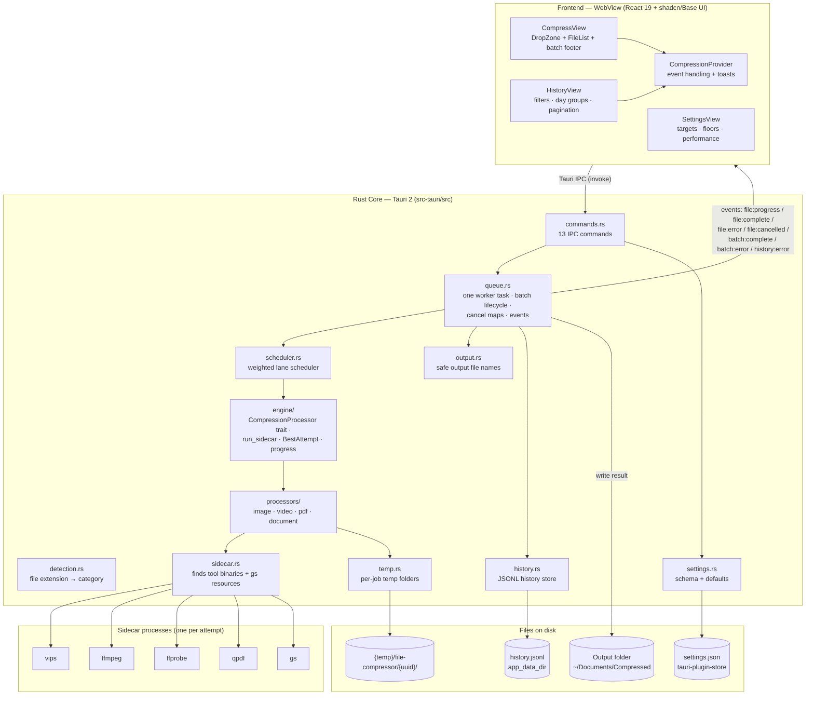
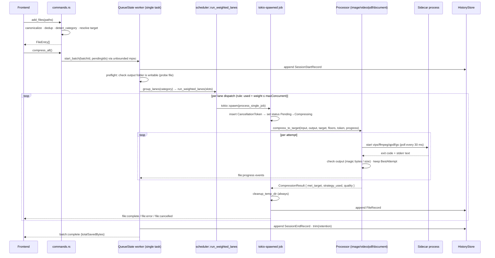

# File Size Optimizer — Architecture (as implemented)

**Date:** 2026-10-05
**Scope:** This document describes the code **as it exists today**, not the design spec. If this document and `docs/superpowers/specs/2026-09-27-file-size-optimizer-design.md` disagree, this document is correct.
**Audience:** Developers working on this repo. Claims point to a file and line where useful.

---

## 1. What the app does

An **offline desktop app** that compresses many files at once. Each file gets a size target based on its category (image, video, PDF, or document). The user drags files in, the app compresses them with external command-line tools, and the results appear in the list. Original files are never changed. Compressed copies go to a separate output folder. The app never uses the network: no server, no accounts, no telemetry.

- Platforms: macOS, Windows (Linux works at the code level but is not packaged or tested yet).
- License: GPLv3. Tool licenses: FFmpeg GPLv2+, Ghostscript AGPLv3, libvips LGPLv3, qpdf Apache-2.0.

---

## 2. Tech stack (exact versions in use)

| Layer | Technology | Version |
|---|---|---|
| Desktop framework | Tauri | 2.12.0 |
| Frontend | React + TypeScript | 19.3.0 / 6.0.3 |
| Bundler | Vite (uses Rolldown) | 8.3.1 |
| UI components | shadcn/ui (**Base UI version**, not Radix) | 4.21.0 (`@base-ui/react` 1.8.0) |
| Styling | Tailwind CSS (CSS-first config, green oklch theme) | 4.3.3 |
| Icons / toasts / font | `@remixicon/react` / sonner / Inter variable | 4.9.0 / 2.0.8 / 5.3.0 |
| Async runtime | Tokio + tokio-util (CancellationToken) | 1.53.1 / 0.7.19 |
| Serialization | serde, serde_json | 1.0.229 / 1.0.151 |
| Zip repack | `zip` crate (deflate only) | 8.6.0 |
| IDs / paths | uuid v4 / dirs | 1.26.1 / 7.0.0 |
| Settings | tauri-plugin-store | 2.5.0 |
| Dialog / opener | tauri-plugin-dialog / -opener | 2.8.0 / 2.6.0 |

**External tools** ("sidecars", pinned and checksum-verified in `scripts/binaries.lock.json`):

| Tool | Version | Used for |
|---|---|---|
| `vips` | 8.18.7 | Image compression + images inside documents |
| `ffmpeg` / `ffprobe` | 9.0.2 | Video encoding (two passes) + reading video info |
| `qpdf` | 12.4.2 | Light PDF optimization passes |
| `gs` (Ghostscript) | 10.08.0 | Strong PDF compression |

Rust release build settings: `lto=true, codegen-units=1, opt-level=3, panic="abort", strip=true` (`src-tauri/Cargo.toml`).

---

## 3. High-level architecture



**Main rule (true in the code):** all compression logic lives in Rust. The frontend only sends commands and shows results. The webview does no compression work.

---

## 4. Frontend

### 4.1 Views and navigation

- There is no router. `src/App.tsx` stores `activeView: "compress" | "history" | "settings"` in `useState` and shows one view at a time. **History state (filters, page, search) resets when you switch views**, because views unmount.
- `CompressionProvider` (`src/providers/CompressionProvider.tsx`) wraps the whole app. This keeps the compress file list alive when you switch views.
- Dark mode: `src/main.tsx:23-27` checks `prefers-color-scheme` and toggles the `.dark` class on `<html>`. `next-themes` is installed but not used (sonner falls back to `"system"`).

### 4.2 State

| State | Owner | Notes |
|---|---|---|
| `files: FileEntry[]` | `useFileList` | Mirrors Rust `FileListState`. The `add_files` response decides category and target — the frontend does not guess. |
| `isCompressing`, `progressByFile` | `useCompression` | Updated from events. Counters (`processedCountRef`, `errorCountRef`) live in refs so they do not cause re-renders. |
| History page/filters | `useHistory` | Local to the view. `PAGE_SIZE = 50`. The backend can correct the page number; the hook applies the correction once. |
| Settings draft | `useSettings` | A copy of settings for editing. Dirty check compares JSON. A `mutationCountRef` prevents a race between save and the initial load. |

Two sync directions:

1. **Frontend starts a change:** call the Rust command first, then update local state with the response.
2. **During a batch:** Rust is the source of truth. The frontend listens to events and updates state (`file:progress` → set status to `compressing`, update percent; `file:complete` → update the file entry). Events for files that were removed mid-batch are ignored (`useCompression.ts:118,133`).

### 4.3 IPC surface (actual)

**Commands** (frontend → Rust; all run synchronously except `get_history`):

| Command | Payload → Rust | Returns |
|---|---|---|
| `add_files` | `filePaths: string[]` | `FileEntry[]` (category + target resolved in Rust) |
| `remove_file` / `clear_list` | `fileId` / — | nothing |
| `get_settings` / `save_settings` / `reset_settings` | — / `{settings}` / — | `Settings` / nothing / `Settings` |
| `compress_all` | — | `batchId: string` (empty string `""` means the batch was empty) |
| `cancel_file` / `cancel_all` | `fileId` / — | nothing (fire-and-forget) |
| `reveal_in_folder` | `filePath` | `Result<(), string>` |
| `get_history` | `{filters, page, pageSize}` | `HistoryResponse` |
| `clear_history` | — | `Result<(), string>` |
| `open_folder` | `path` | `Result<(), string>` |

**Events** (Rust → frontend):

- `file:progress` — `{fileId, percent}`
- `file:complete` — `{fileId, outputPath, originalSize, compressedSize, status, metTarget, qualityUsed, strategyUsed}`
- `file:error` — `{fileId, errorMessage}`
- `file:cancelled` — `{fileId}`
- `batch:complete` — `{batchId, totalSavedBytes}`
- `batch:error` — `{batchId, errorMessage}`
- `history:error` — `{message}` (sent at most once per batch)

Naming rules on the wire: payload fields are camelCase. `FileStatus` values are `snake_case` (for example `already_under_target`), `Category` values are lowercase (`src-tauri/src/models.rs:29-40`).

Capabilities (`src-tauri/capabilities/default.json`) only grant plugin defaults (`core`, `opener`, `dialog`, `store`) to window `main`. Custom commands need no capability entries. CSP: `script-src 'self'` (strict); `style-src 'unsafe-inline'` is needed by Tailwind.

### 4.4 Rendering cost (matters for performance — see `docs/CAPACITY.md`)

- `FileList` rows are **not memoized** and the list is **not virtualized** (`FileList.tsx:125-229`). Every `file:progress` event rebuilds the whole files array and re-renders the full table.
- There is **no throttling** on either side. Video progress sends one event per ffmpeg output line (can be more than 10 per second), times up to 3 jobs at once.
- `CompressView` runs 8 `files.filter()` calls on every render to build the batch summary (`CompressView.tsx:49-69`).
- HistoryView and SettingsView do not use the compression context, so they do not re-render on progress events.

---

## 5. Rust core

### 5.1 Module map

```
main.rs ─► lib.rs::run()
             ├─ plugins: opener, dialog, store          lib.rs:89-91
             ├─ .manage(FileListState)                  lib.rs:92
             ├─ .setup(setup_hook)                      lib.rs:93
             │    ├─ QueueState::new → starts worker    queue.rs:136-152
             │    ├─ temp::cleanup_stale_temp_files     temp.rs:36-114 (removes files older than 24h)
             │    └─ setup_history → HistoryStore + trim
             └─ invoke_handler[13 commands]             lib.rs:66-84

commands.rs ─► models, detection, settings, history, QueueState, store plugin, opener
queue.rs    ─► FileListState, engine, history, models, processors, scheduler, sidecar, temp, output
scheduler.rs ─► standalone (std + tokio only)
engine/*    ─► processor trait, sidecar runner, progress sender, error types
processors/* ─► engine helpers + sidecar.rs path lookup (video starts ffmpeg directly to read live progress)
sidecar.rs  ─► leaf module; produces engine::SidecarPaths, used by all processors
settings.rs / history.rs / temp.rs / output.rs — mostly standalone data + file I/O
```

### 5.2 Job lifecycle (start to finish)



Details that matter:

1. **One worker, batches run one after another.** `QueueState::new` starts exactly one worker task. It loops on a `tokio::sync::mpsc::unbounded_channel` (`queue.rs:131-152`). Two batches never overlap. Parallel work happens **inside** one batch.
2. **Preflight check.** Before any job runs, the app creates the output folder and writes then deletes a `.write-probe` file. If this fails, the app emits `batch:error` and writes no history record (`queue.rs:904-917`).
3. **Cancel token is registered before the status change.** The per-file `CancellationToken` goes into `token_map` **before** the status changes from `Pending` to `Compressing`. This way `cancel_file` can never miss a job that just started (`queue.rs:473-477`).
4. **Panics are contained.** If a processor panics, `catch_unwind(AssertUnwindSafe(...))` catches it and turns it into `Unknown("job panicked: …")` (`queue.rs:584-598`).
5. **Output file names.** `output.rs:26-116` tries `name`, then `stem-1.ext` up to `stem-999.ext`, then `stem-overflow.ext`, then `stem-overflow-{uuid}.ext`. An in-memory `ReservedNames` registry (key: `folder\0name`) stops two parallel jobs from taking the same name. Extension rewrite happens first (`.heic/.heif → .jpg`, `.mov → .mp4`, `queue.rs:53-69`).
6. **History writes.** File records collect in `history_records: Mutex<HashMap<batch_id, Vec<FileResultRecord>>>` and are written out in `finish_batch`. If a write fails, the app sends one `history:error` per batch. Compression results are never affected.

### 5.3 Concurrency: the weighted lane scheduler

`src-tauri/src/scheduler.rs:28-98` — `run_weighted_lanes<J>`:

- **One lane per category.** At most **one job runs at a time within a category** (`scheduler.rs:52-53`). Two images never compress at the same time.
- **Slot budget.** A lane may start a job only if `used + lane.weight ≤ max_slots`. **Video costs 2 slots** (`queue.rs:866-868`); everything else costs 1. So two videos never run at the same time, even with 4 slots.
- **Order.** Lanes dispatch in insertion order (batch order), oldest job first. Each loop iteration starts at most one job. When no lane can start a job, the scheduler waits on all running jobs and takes the first one that finishes (`poll_fn`).
- **Cancel-all behavior.** When the batch cancel token fires, all jobs still waiting in lanes go through `on_skipped` → `file:cancelled` event + cancelled history record.
- **How `maxConcurrent` is resolved** (`settings.rs:240-263`): `"auto"` → `(CPU core count / 2).clamp(1, 4)`; `"1"|"2"|"3"` used as-is; anything else → 1 with a warning. Test-pinned results: 1→1, 2→1, 3→1, 4→2, 8→4, 16→4.

Each job is a `tokio::spawn`ed future that runs blocking 30 ms poll loops inside. So each active job holds one tokio worker thread for its whole duration. This is fine at maxConcurrent ≤ 4. It would matter if the auto formula ever allowed more jobs (see `docs/CAPACITY.md` §6).

### 5.4 Cancellation

- Storage: `token_map: Mutex<HashMap<file_id, CancellationToken>>` and `batch_tokens: Mutex<HashMap<batch_id, CancellationToken>>` (`queue.rs:127-128`).
- `cancel_file` (`commands.rs:203-227`): if the job already started, cancel its token. If not, change the status to `Cancelled` in the list and emit `file:cancelled` directly.
- `cancel_all` (`queue.rs:182-189`): cancels every batch token, then every file token.
- How killing works (`engine/processor.rs:218-301`): the runner polls `try_wait` every 30 ms. On cancel it calls `child.kill()` (SIGKILL) + `wait()` and returns `Err(Cancelled)`. **A cancel always wins over the exit code** — the code re-checks cancellation after the process ends. SIGKILL only kills the direct child process. Grandchild processes survive and keep the stderr pipe open, so on cancel the drain thread is left running and only joined with a 5 s limit on normal exit.
- Cleanup on cancel, per processor: video deletes attempt outputs and passlog files (`video.rs:356-382,731-736`); PDF deletes all attempt files (`pdf.rs:338-341`); image checks the token on every iteration; document re-checks the token at every file-copy step and never deletes a file that already existed at the output path (`document.rs:244-256`).
- Temp folder cleanup runs after every job, always — success, error, or cancel (`queue.rs:611-612`).

### 5.5 Running sidecar tools

- **Finding binaries** (`sidecar.rs:60-80,135-175,340-343`): on Windows the engines that need sibling DLLs live under `<install root>/resources/engines/<engine>/`, one folder per engine, and the resolver probes `{exe_dir}/resources/engines/{name}/…` first, then the dev-checkout `{exe_dir}/../../binaries/engines/{name}/…`. Flat (`externalBin`) candidates are, in order: `{exe_dir}/{name}-{target_triple}[.exe]` (the triple-suffixed staged name), `{exe_dir}/{name}` (the macOS/Linux bundle layout), and `{exe_dir}/{name}.exe` (the Windows bundle layout — the bundler strips the target-triple suffix and keeps `.exe`). ffmpeg/ffprobe use only the flat candidates. On macOS the engines are flat in `Contents/MacOS/` because they are `externalBin`.
- **Environment:** only `PATH` is changed, and only on Windows — the engine's own DLL folder is put first (`sidecar.rs:122-135`). No TMPDIR or other variables are set. Temp handling happens through explicit path arguments.
- **Generic runner** (`engine/processor.rs:218-301`): stdout goes to null; stderr is piped and read on a separate thread into a `Vec` (this prevents a deadlock when the pipe fills). Poll loop every 30 ms. Each engine can define which exit codes are acceptable (`ToleratedExit`): qpdf exit 2 means "warnings only", and the output is still used. Failure message: `"{label} exited with code {code:?}: {stderr_tail}"`, where the tail keeps the last 500 characters.
- **ffmpeg progress** (`video.rs:497-617`): a reader thread reads 4096-byte chunks and splits lines at the last `\n` **or** `\r` (ffmpeg `-stats` uses `\r`). The diagnostics tail is capped at 2048 bytes. Each line is checked for `time=HH:MM:SS.ms` and `out_time_ms=` (this value is in microseconds even though the name says ms). The larger value wins, is clamped to 0-100, and is mapped into the current attempt's progress range. The reader thread is joined with a 5 s limit.
- **gs-resources** (`sidecar.rs:190-328`): the folder must contain `Resource/Init/gs_init.ps` plus real font files in both `Resource/Font` and `fonts`. Search dirs: `["Resource/Init","lib","Resource/Font","fonts"]`. `iccprofiles/` is passed as `-uICCProfilesDir=` (the `-s` version makes gs 10.08 pdfwrite abort). If the folder is missing, gs still runs without `-I`, and a failing pass gets a `GS_RESOURCES_MISSING` hint in the error.

---

## 6. Processor algorithms

All processors implement `engine::CompressionProcessor` and share this behavior:

- If the file is already under the target → plain copy, status `already-under-target`.
- Each attempt writes to its own temp file `attempt-{n}.{ext}`. Attempt files stay on disk until the job ends.
- A `BestAttempt` tracker keeps the smallest output so far (a new attempt must be strictly smaller to replace it).
- Every output is validated. Exit code 0 does not mean success.

### 6.1 Image (`processors/image.rs`)

- Output formats: jpg/jpeg→jpg, png→png, webp→webp, heic/heif/unknown→jpg. PNG saves with `[compression=9,palette,colours=256,strip]`; others with `[Q={q},strip]`.
- **Phase 1 — quality binary search:** lower bound = `image.minQuality` (default 30), upper bound = 95, at most 8 iterations (`MAX_SEARCH_ITERATIONS`). Each iteration runs `vips copy IN OUT[opts]` into its own temp file. **PNG skips phase 1** (PNG has no lossy quality setting). Progress = `iteration*100/8`, capped at 90.
- **Phase 2 — smaller dimensions:** `vips resize` at `min_quality`, scale from 90% down to 50% in 10% steps (`SCALE_FLOOR_PERCENT = 50`). Strategy label: `quality={q},dims={p}%` (or `palette,dims={p}%` for PNG).
- **Phase 3 — best effort:** deliver the smallest attempt recorded, with `met_target=false`.

### 6.2 Video (`processors/video.rs`)

- Constants: resolution steps `[(1080,1920),(720,1280),(480,854)]`, filtered by the `minResolution` setting; CRF steps `[23,28]` plus the floor value; audio 128 kbps AAC; pass-1 output goes to `/dev/null` (`NUL` on Windows); clips shorter than 0.5 s are rejected.
- **Bitrate formula** (`video.rs:85-100`): `kbps = (target_bytes × 8 × 0.95) / duration_ms` (u128 math with overflow guards).
- **Per resolution step:** two-pass `libx264` encode. Pass 1 writes only the passlog files (`-0.log`, `-0.log.mbtree`). Pass 2 writes `attempt-{i}.mp4`. The output is checked for the MP4 `ftyp` marker and nonzero size. Failed attempts are deleted right away; over-target attempts are kept as best-effort candidates; passlogs are deleted after each attempt.
- **CRF fallback** at the lowest allowed resolution, single pass, steps `[23,28] ≤ minCrf` plus the floor value.
- Progress: each attempt gets an equal share of 0-95 (`span = 95 / total_attempts`), split across its two passes.
- ffprobe: `-show_entries format=duration`. Non-zero exit → "File may be corrupt".

### 6.3 PDF (`processors/pdf.rs`)

A ladder of passes. The ladder stops at the first pass that meets the target (`pdf.rs:220-235`):

1. `qpdf-lossless` — `--linearize --object-streams=generate --compression-level=9`
2. `qpdf-image-opt` — adds `--recompress-flate --optimize-images --jpeg-quality=75`
3. `gs-screen` — `-dPDFSETTINGS=/screen` (only if 72 ≥ minDpi and 15 ≥ minJpegQ)
4. **gs grid** — dpi ∈ [100,72,50,36] × jpegq ∈ [60,40,25,15], filtered by the user's floors. With default floors this leaves 8 grid cells, so at most 17 gs runs total.

qpdf exit 2 is accepted as success-with-warnings. Outputs are checked for the `%PDF-` header and nonzero size. A failing pass never stops the ladder — the next pass runs anyway.

### 6.4 Document (`processors/document.rs`)

- **Snapshot:** the whole zip is read into RAM (`Vec<ZipEntry { name, is_dir, content: Vec<u8> }>`). This is the app's largest per-job RAM consumer. A broken zip → "File may be corrupt".
- Media folders: only the exact prefixes `word/media/`, `ppt/media/`, `xl/media/`. Similar-looking folders (like `word/mediaExtra/`) pass through unchanged.
- **Documents with no media:** one rezip at deflate level 9 (`rezip-deflate9`).
- **Binary search** between `minMediaQuality` and 95, at most 8 passes. Per pass: each media entry is written to `media-{pass}-{index}.{ext}`, recompressed by `vips copy [Q={q},strip]`, and read back from `-out.{ext}`. **If vips fails on one entry, that entry keeps its original bytes and the job continues.** Then the whole archive is rewritten (original entry order) at deflate level 9 into `attempt-{pass}.{ext}`.
- Every file-copy step re-checks the cancel token (`deliver_or_cancel`).

---

## 7. Data stored on disk

| File | Location | Format | Lifecycle |
|---|---|---|---|
| Settings | `settings.json` (tauri-plugin-store), single key `"settings"` | JSON, camelCase, all fields `#[serde(default)]` | Read when needed; unreadable file → defaults; `reset_settings` writes defaults back |
| History | `{app_data_dir}/history.jsonl` | JSONL, 3 record types (`session_start`, `file`, `session_end`), camelCase | Appended per file and per batch. Retention trim (default 90 days, allowed 1..=3650) runs at startup and after every batch. The trim writes a temp file and renames it (atomic). If the app crashed mid-write, a newline check repairs the file. |
| Temp | `{OS temp}/file-compressor/{uuid-v4}/` | Attempt outputs, passlogs, media scratch files | Deleted after every job. At startup, entries older than 24 h are deleted. |
| Outputs | Settings `outputFolder` (default `~/Documents/Compressed`) | Same format as input (HEIC→JPG, MOV→MP4) | Never deleted automatically; names avoid collisions |

How history queries work (`history.rs`): `get_history` reads and **parses the entire file on every call**. Rules: a repeated `session_start` replaces the earlier one; a repeated `file_id` inside a session replaces the earlier one; lines that do not fit anywhere are skipped and counted (`skippedLines`); a session without an end record is marked `interrupted` and its totals are recomputed. Filters: `search` (case-insensitive text match, sets `matchedFiles`), `statuses`, `categories`, `sinceMs`, `outputFolder`. Pagination: default 50, max 200. A session is never split across two pages. The requested page is clamped to the last valid page.

---

## 8. Errors and fallback behavior

- Internal error type: `CompressionError { Cancelled, SidecarNotFound, SidecarFailed, InputFileError, OutputFileError, DiskFull, Unknown }`. The user-facing text of each variant is **pinned by a test** (`engine/result.rs:70-112`). There are no wildcard match arms — adding a new variant breaks the test on purpose.
- Across IPC: `Result<T, String>`. Compression errors reach the UI as strings inside events.
- If a Mutex is poisoned (a thread panicked while holding it), the code recovers with `unwrap_or_else(|e| e.into_inner())` and logs a warning. A panic never blocks the app permanently.
- Fallback behavior when something is broken:
  - History store missing → history is disabled silently; batches still finish.
  - History write fails → one `history:error` per batch; results unaffected.
  - Settings file unreadable → defaults are used.
  - gs resources missing → gs still runs; failures get a hint in the error message.
- Exit code 0 does not mean success: every processor checks output magic bytes and size (`ftyp` for MP4, `%PDF-` for PDFs, zero-byte rejection for vips, zip open test for OOXML).

---

## 9. Build, packaging, and sidecar supply chain

- **Manifest = intention, lock = truth.** `scripts/binaries.manifest.json` (edited by hand: download URL, sha256, expected version for each tool and target) → `yarn binaries:fetch` verifies checksums, stages the files, and writes `scripts/binaries.lock.json`. `binaries:prep` collects macOS dylibs (sets rpath, ad-hoc signs) and prepares Windows engine folders. `binaries:verify` checks CPU architecture vs file name and version vs lock. `binaries:audit` includes a clean-room Ghostscript test (runs with an empty environment + sentinel files).
- **Bundle layout:** macOS ships flat `externalBin` files + 71 framework dylibs listed under `bundle.macOS.frameworks` in `tauri.conf.json` + `gs-resources/`. Windows ships ffmpeg/ffprobe flat + vips/gs/qpdf as one resource folder per engine (source `binaries/engines/{name}/`; the destination is set in `tauri.windows.conf.json`) with DLLs (the Windows config overrides `externalBin` with an array replace, per RFC 7396).
- **Size:** spec §2 targets about 150 MB per platform; the measured aarch64 release `.app` is ~214 MiB of files (~215 MiB on disk) with all sidecars and framework dylibs staged.
- **CI/CD:** four workflows exist — `ci.yml` (PR/push gate on macOS arm64 + Windows x64), `freeze.yml` (manual engine freeze into `sidecars-*` releases), `release.yml` (`v*` tag → four native platform builds, draft upload) and `release-please.yml` (release PRs from conventional commits). Known blocker: on a fresh clone, `cargo test` fails before `yarn binaries:all` runs, because `bundle.externalBin` requires binaries that only the fetch step creates.

---

## 10. Implementation status and known gaps

**Done and merged:** app shell, file detection, settings, image/PDF/video/document compression, parallel weighted-lane scheduler, history audit trail (store + UI), sidecar manifest/lock pipeline (mac arm64 verified end-to-end).

**Deferred or open:**

| Item | Status |
|---|---|
| Windows Ghostscript resource tree | **Blocker** — the pinned MSYS2 package has no `Resource/`, `fonts/`, or `iccprofiles/`. PDF compression would fail on Windows. `prep-windows.mjs` fails loudly on purpose (`docs/bugs.md`). |
| CI/CD | `ci.yml`, `freeze.yml`, `release.yml`, `release-please.yml` exist; release rows not yet proven end-to-end (see `docs/ci-followups.md`). |
| Windows/Intel sidecar end-to-end verification | Waiting for a Windows machine or CI runner. |
| GUI manual tests (parallel + history acceptance tables) | Pending — several acceptance rows are marked PENDING-MANUAL. |
| Frontend rendering at scale | No virtualization, memoization, or throttling on progress events (see `docs/CAPACITY.md` §6). |
| `next-themes` | Installed but unused (no ThemeProvider). |
| Version strings | `package.json` says 0.1.0, the sidebar footer says "v1.0.0". |
| File picker filter | `open({ filters: [] })` — no extension filter. Unsupported files are rejected after adding. |
| History state across navigation | Filters/page/search reset when switching views (views unmount). |

**Not in v1 (per spec §9, still true):** per-file target override, batch presets, HEIC output, EMF/WMF conversion, magic-byte file detection, telemetry, auto-update.

---

## 11. Diagram index

1. §3 — High-level components and data flow (main diagram)
2. §5.2 — Job lifecycle sequence diagram
3. §5.3 — Concurrency model (text + test references)
4. `graphify-out/graph.html` — auto-generated knowledge graph (browsable)

---

*All `file:line` references in this document point at the working tree as of 2026-10-05 (after PR #80).*
