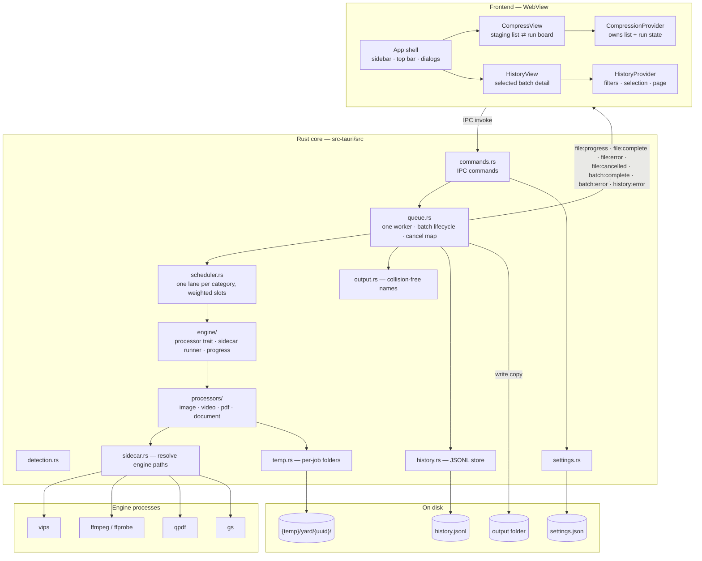
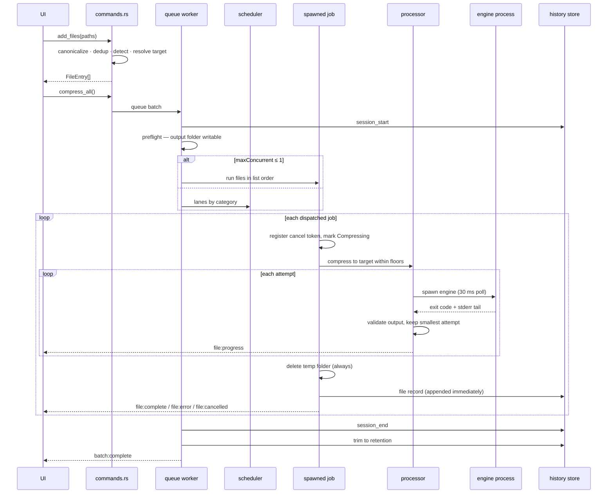

# Yard — Architecture

**Scope:** the code as it exists today. Design intent and rejected alternatives live in `docs/adr/`. What shipped lives in `docs/FEATURES.md`. Known gaps live in `docs/bugs.md`.

## 1. What it is

An offline desktop app that compresses batches of files toward a per-category size target. The user stages files, presses Compress, and the app runs bundled command-line engines over them. Originals are never modified; results are written as copies to a separate output folder. No network, no accounts, no telemetry.

- Platforms: macOS (arm64, Intel) and Windows (x64, arm64). Linux builds from source but is not packaged.
- License: GPLv3. Engines keep their own licenses — FFmpeg GPLv2+, Ghostscript AGPLv3, libvips LGPLv3, qpdf Apache-2.0.

## 2. Stack

| Layer | Technology |
|---|---|
| Desktop shell | Tauri 2.12 (Rust) |
| Frontend | React 19.3 + TypeScript 7.0 + Vite 8.3 (Rolldown) |
| UI | shadcn/ui 4.21 on Base UI (`@base-ui/react` 1.9), Tailwind CSS 4.3, motion 14, sonner |
| Rust | Tokio, serde, uuid, dirs, `zip` (deflate only) |
| Tauri plugins | opener, dialog, store, os, window-state, single-instance |
| Engines | vips 8.18.7, ffmpeg/ffprobe 9.0.2, qpdf 12.4.2, gs 10.08.0. Intel macOS is pinned one release behind: vips 8.18.6 / gs 10.07.1 (ADR 0001) |

Release profile: `lto`, `codegen-units=1`, `opt-level=3`, `panic=abort`, `strip`.

## 3. Components



**Boundary rule:** `src/` renders and calls IPC; every compression decision lives in `src-tauri/src/`.

## 4. Frontend

### Shell

`main.tsx` applies the stored or OS theme before the first render, detects the platform synchronously through `plugin-os`, then mounts `ErrorBoundary → PlatformProvider → App`.

```
PlatformProvider
└── CompressionProvider
    ├── QuitGuard
    └── HistoryProvider
        └── SidebarProvider
            ├── Sidebar (stock shadcn, offcanvas)
            ├── SidebarInset: TopBar + active view
            └── SettingsDialog · AboutDialog · HistoryFilterDialog · Toaster
```

- `Shell` (inside `App.tsx`; `App` itself only mounts the providers) owns `activeView` (`compress` | `history`) plus the settings, About and filter dialog state. One view is mounted at a time; there is no router.
- The top bar holds the breadcrumb, theme toggle and ⋯ app menu; on non-macOS platforms it adds minimize/maximize/close. The sidebar header owns the collapse trigger on every platform while the sidebar is open; the top bar renders `SidebarActions` only while the sidebar is hidden (on macOS it keeps the `pl-22` traffic-light clearance). ☰ appears only while the sidebar is hidden. The whole bar is a drag surface and interactive children stop propagation. See ADR 0007.
- The sidebar is the stock shadcn `Sidebar`: `offcanvas` on desktop, the vendored Sheet below 768px, stock widths (16rem / 18rem). `src/components/ui/sidebar.tsx` keeps two local tweaks: `min-w-0` on `SidebarInset`, and `SidebarTrigger` carries the collapse/expand label with fold/unfold icons. Open state is session-only.
- `HistoryList` lives inside the sidebar — batch rows and pagination, the only scroller in the sidebar. The History nav row is a disclosure that shows or hides that list and never changes the active view; only a batch row navigates. Selecting a batch focuses its detail in `HistoryView` and adds its label to the breadcrumb; the detail card scrolls its own content. There is no sidebar search field; `HistoryFilters.search` stays available below the UI.
- Settings and About are dialogs; there is no settings view. Settings auto-save after a 400 ms debounce and flush on close.

### Views

- `CompressionProvider` and `HistoryProvider` sit above the view switch, so the staged list, an in-flight run, history filters and the selected batch survive navigation.
- Compress has two screens: **staging** (drop zone + file list + summary footer) and **run** (header + kanban board, one lane per category). "New batch" clears the list and returns to an empty staging screen.
- History is a detail pane for the batch selected in the sidebar; there is no third column.
- Dark mode: `useTheme` reads `localStorage["yard-theme"]`, follows `prefers-color-scheme` when unset, toggles `.dark`, and syncs the native window theme. `main.tsx` applies the first value before `createRoot`.

### State ownership

| State | Owner |
|---|---|
| `activeView`, settings/About/filter dialog open | `Shell` inside `App.tsx` |
| sidebar open (desktop `open`, mobile Sheet `openMobile`) | `SidebarProvider` — session-only |
| history expanded, selected batch, filters/sort/page/search/data | `HistoryProvider` over `useHistory` |
| `files`, list error | `useFileList` — every mutation calls Rust first, then stores the returned list |
| run screen, batch number, roster, batch outcome | `CompressionProvider` |
| `isCompressing`, `progressByFile` | `useCompression` — driven by events |
| window-close interception | `QuitGuard` under `CompressionProvider` — reads `isCompressing` |
| platform | `PlatformProvider` over `plugin-os` |
| theme | `useTheme` — localStorage, OS fallback |
| settings draft | `SettingsDialog` — boolean dirty ref, 400 ms debounce and flush on close; `useSettings` owns the loaded settings and the load/save race guard |

During a batch Rust is authoritative: the frontend applies events and ignores events for files that left the list. See ADR 0004.

### IPC surface

Commands (frontend → Rust): `add_files`, `remove_file`, `clear_list`, `get_settings`, `save_settings`, `reset_settings`, `compress_all`, `cancel_file`, `cancel_all`, `reveal_in_folder`, `get_history`, `clear_history`, `open_folder`, `quit`.

Events (Rust → frontend): `file:progress`, `file:complete`, `file:error`, `file:cancelled`, `batch:complete`, `batch:error`, `history:error`. Payload fields are camelCase on the wire; `FileStatus` values are snake_case (`already_under_target`, `best_effort`, …) and categories are lowercase.

`HistoryFilters` carries `sort` (`newest` default, `oldest`). Sorting happens before pagination; an absent or unknown value falls back to `newest` (`sort: null` is valid).

Capabilities grant plugin defaults, `os:default`, `window-state:default`, and window start-dragging/minimize/toggle-maximize/close/set-theme to window `main`; custom commands need no entry. CSP is `script-src 'self'` with `style-src 'unsafe-inline'` for Tailwind.

Window chrome and plugin wiring: macOS uses an overlay title bar, Windows is frameless with the default shadow, Linux keeps native decorations and is not packaged. `window-state` restores size, position, maximized, visible and fullscreen, but never decorations; `single-instance` focuses the existing window on a second launch. See ADR 0007.

### Rendering cost

List rows and kanban cards are not memoized and lists are not virtualized. Every `file:progress` event re-renders the active run view, and video emits one event per ffmpeg output line. This is a known performance debt, not a correctness problem (`docs/bugs.md`).

## 5. Rust core

### Module map

```
lib.rs          plugin wiring, macOS menu, managed state, setup hook, command registry
commands.rs     IPC surface + settings load/save + file list state
queue.rs        single worker task, batch lifecycle, cancel maps, events
scheduler.rs    generic weighted-lane scheduler (no Tauri dependency)
engine/         CompressionProcessor trait, sidecar runner, progress, errors
processors/     one module per category
sidecar.rs      engine path resolution + gs resource discovery
detection.rs    extension → category
output.rs       collision-free output names + reservation registry
temp.rs         per-job temp folders + 24 h startup sweep
history.rs      JSONL records, folding, filtering, retention
settings.rs     schema, defaults, target resolution
```

`QueueState::new` starts exactly one worker task. Batches never overlap; parallelism happens inside a batch.

### Batch lifecycle



Details that change behavior:

1. **Preflight.** The app creates the output folder and writes/deletes a probe file. Failure emits `batch:error` before any history record is written.
2. **Cancel tokens register before the status flips** from Pending to Compressing, so a cancel can never miss a job that just started.
3. **Panics are contained** by `catch_unwind` and reported as an unknown error.
4. **Output names** try `name.ext`, `stem-1.ext` … `stem-999.ext`, then `stem-overflow.ext`, then a uuid fallback. An in-memory reservation registry stops parallel jobs from claiming the same name. Extensions are rewritten first: HEIC/HEIF → JPG, MOV → MP4.
5. **History is append-per-record.** A failed write emits one `history:error` per batch; compression results are unaffected.

### Concurrency (ADR 0003)

- One lane per category; at most one job per lane.
- A job may start only if `used + weight ≤ maxSlots`. Video weighs 2, everything else 1 — so two videos never overlap, even at 4 slots.
- `maxConcurrent`: `"auto"` → `clamp(cores / 2, 1, 4)`; `"1" | "2" | "3"` used as-is; anything else → 1 with a warning.
- With one slot the scheduler is bypassed and files run in list order.
- Cancel-all drains every lane through `on_skipped`, emitting `file:cancelled` plus a cancelled history record.

Each running job is a spawned future that holds a worker thread for its duration because the engine runner polls every 30 ms. Safe at ≤ 4 slots.

### Cancellation

`cancel_file` cancels a live token or, if the job has not started, marks the entry cancelled directly. `cancel_all` cancels every batch token, then every file token. The runner calls `kill()` and re-checks cancellation after the process exits, so a cancel always wins over an exit code. SIGKILL reaches only the direct child; a drain thread may linger. Per-processor cleanup: video deletes attempt outputs and passlogs, PDF deletes attempt files, image checks the token each iteration, document re-checks at every copy step and never deletes a pre-existing output. Temp cleanup always runs at job end.

### Engine processes

- **Resolution order.** Windows engines that need sibling DLLs live in `<install>/resources/engines/<name>/`; the resolver probes that first, then the dev-checkout layout. Flat candidates: `{name}-{triple}[.exe]`, `{name}`, `{name}.exe`. ffmpeg/ffprobe use flat candidates only. macOS ships all engines flat in `Contents/MacOS/`.
- **Environment.** Only `PATH` is touched, and only on Windows (the engine's DLL folder goes first). Windows child processes are spawned with `CREATE_NO_WINDOW` so no console flashes.
- **Runner.** stdout is discarded; stderr is drained on a thread into a bounded tail (500 characters in generic failures, 2 KB for video diagnostics). Poll every 30 ms. Each engine may tolerate exit codes (qpdf 2 = warnings, output still used).
- **Video progress** parses `time=` and `out_time_ms=` (microseconds despite the name) from the ffmpeg stream, takes the larger value, and maps it into the current attempt's range.
- **gs resources.** The macOS package carries a `gs-resources` tree; its absence degrades to a hint in the error, not a hard failure. Windows uses Ghostscript's compiled-in tree (ADR 0001).

## 6. Processors

All processors share one contract: an input already under target becomes a plain copy (`already_under_target`); each attempt writes its own temp file; a `BestAttempt` tracker keeps the smallest strictly-smaller result; every output is validated — exit code 0 is not success.

| Category | Ladder | Validation |
|---|---|---|
| Image | Quality search (≤ 8 steps, floor → 95); then dimensions 90 % → 50 % in 10 % steps; then best effort. PNG skips the quality step and uses palette compression. | Non-zero size |
| Video | Bitrate `target × 8 × 0.95 / duration`, two-pass libx264; if over, step 1080 → 720 → 480 within the resolution floor; then single-pass CRF fallback. Audio 128 kbps AAC. Clips < 0.5 s rejected. | `ftyp` marker + size |
| PDF | qpdf lossless → qpdf image pass → gs `/screen` → gs grid (dpi 100/72/50/36 × jpegq 60/40/25/15, filtered by floors). A failing pass never stops the ladder. | `%PDF-` header + size |
| Document | Whole OOXML archive read into RAM; only `word/media/`, `ppt/media/`, `xl/media/` entries recompressed (≤ 8 quality steps); archive rewritten at deflate 9. A media entry that fails keeps its original bytes. | Zip opens cleanly |

Never use ffmpeg `-fs`: it truncates the file. Size is controlled by bitrate, then resolution, then CRF.

## 7. Data on disk

| Data | Location | Notes |
|---|---|---|
| Settings | `settings.json` via plugin-store, key `settings` | camelCase; every field defaulted; unreadable file falls back to defaults |
| History | `{app_data_dir}/history.jsonl` | Append-only, three record kinds, camelCase. Retention trim (default 90 days, 1…3650) runs at startup and after each batch via temp file + rename. Corrupt lines are skipped and counted. |
| Temp | `{OS temp}/yard/{uuid}/` | Attempt outputs, passlogs, media scratch. Always deleted at job end; entries older than 24 h are removed at startup. |
| Outputs | Settings `outputFolder` (default `~/Documents/Compressed`) | Never deleted automatically; names avoid collisions |

History queries parse the whole retained file per call (ADR 0005). A session is never split across pages; the requested page is clamped to the last valid one; page size defaults to 50.

## 8. Failure behavior

`CompressionError` = `Cancelled`, `SidecarNotFound`, `SidecarFailed`, `InputFileError`, `OutputFileError`, `DiskFull`, `Unknown`. User-facing strings are pinned by tests; adding a variant breaks the build on purpose. Across IPC errors become strings inside events.

Poisoned mutexes are recovered with a warning, never a permanent stall. Missing history store disables history silently; unreadable settings use defaults; missing gs resources only annotate gs failures. Exit code 0 still gets its output checked.

## 9. Build and supply chain

- **Manifest = intention, lock = truth.** `scripts/binaries.manifest.json` (URL/brew source, sha256, expected version per triple) → `binaries:fetch` verifies and stages → `binaries:lock.json` records what landed. `prep` shapes the platform layouts; `verify` checks architecture and versions; `audit` runs a clean-room gs smoke test.
- **Freeze once, consume everywhere (ADR 0001).** `freeze.yml` stages all four triples and publishes `sidecars-<date>` (8 assets). Every CI consumer unfreezes its triple and verifies the bundle sha; nothing brews outside the freeze run.
- **Packages.** macOS: five `externalBin` engines flat in `Contents/MacOS/`, 71 framework dylibs, `gs-resources`, ad-hoc signed with one entitlement (ADR 0002). Windows: ffmpeg/ffprobe flat beside the exe, vips/gs/qpdf as `resources/engines/<name>/` with their DLLs.
- **Release guard.** Every release row runs `package-gate.mjs`, which opens the built package and runs each engine once. The gate exists because alpha.1 shipped engines that could not start.
- **Workflows.** `ci.yml` (2-row PR gate), `freeze.yml`, `release.yml` (4 native rows), `release-please.yml` (draft release PRs). Details and runbooks: `docs/ci-process.md`.
- Measured macOS arm64 package: ~214 MiB with engines and dylibs.

## 10. Resource limits

| Fact | Value |
|---|---|
| Jobs at once | auto `clamp(cores/2, 1, 4)`; manual 1–3 |
| Same-category jobs | 1 |
| Video cost | 2 slots |
| Engines per job | image ≤ 13 vips runs · video ≤ 10 ffmpeg runs (input read twice per two-pass attempt) · PDF ≤ 19 (2 qpdf + 17 gs) · document ≤ 8 passes over the whole archive |
| Memory | documents dominate: the whole decompressed archive plus recompressed media ≈ 2.5 × uncompressed size (≈ 8–12 × the compressed file) |
| Temp disk | every attempt is kept until the job ends; four large documents ≈ 4 × 8 × uncompressed size |
| CPU | one video encode uses every core; other lanes compete for what is left |
| Webview | every progress event re-renders the run view; no throttling |

Practical worst cases: a 500 MB PPTX needs ~5 GB RAM; a 2 GB PPTX needs ~20 GB. Four 500 MB decks can spike temp disk to ~60 GB. Hardware tiers and the plain-language requirements are in `README.md → System requirements`.

## 11. Read next

- `README.md` — users, install, system requirements, developer setup
- `docs/FEATURES.md` — what shipped, slice by slice
- `docs/adr/` — decisions and rejected alternatives
- `docs/ci-process.md` — CI model, runbook, failure table
- `docs/distribution-acceptance.md` — manual release checklist
- `docs/bugs.md` — open bugs, deferred CI work, known gaps
- `GLOSSARY.md` — project vocabulary
